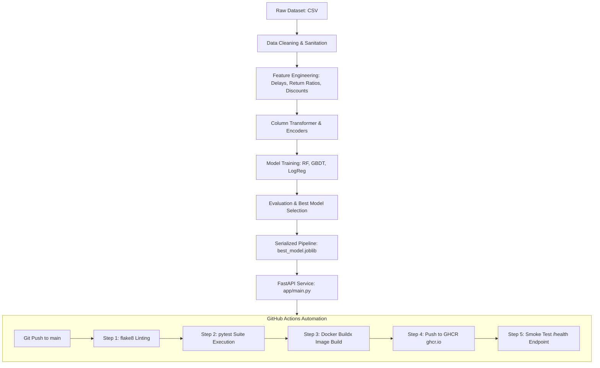

# E-Commerce Product Return Prediction System with Automated CI/CD

[](https://github.com/Tejasaisathwik/ecommerce-product-return-prediction/actions)
[](https://www.python.org/downloads/)
[](https://fastapi.tiangolo.com)
[](https://www.docker.com/)
[](https://scikit-learn.org/)
[](LICENSE)

---

## 📌 Problem Overview
In modern e-commerce, reverse logistics and customer returns represent substantial operational costs and inventory degradation. This project builds a production-grade **Machine Learning prediction service** coupled with an **automated Continuous Integration and Continuous Deployment (CI/CD) pipeline**.

The system predicts whether an ordered product is likely to be **Returned** or **Not Returned** using transactional, customer behavioural, product categorical, and logistics indicators.

---

## 🚀 Key Highlights & Features
1. **Robust Preprocessing & Cleaning:**
   - Detects and sanitizes negative/zero product prices (`Product_Price_INR <= 0`).
   - Bounds out-of-range discount values (`Discount_Percent > 100` or `< 0`).
   - Caps illogical customer histories (`Previous_Returns > Previous_Orders`).
   - Handles missing data using median imputation for numerical features and most-frequent imputation for categorical columns.

2. **Domain-Specific Feature Engineering:**
   - **Delivery Delay:** `Actual_Delivery_Days - Expected_Delivery_Days` (positive values indicate tardiness).
   - **Delayed Shipment Flag:** Binary indicator (`delivery_delay > 0`).
   - **Customer Return Frequency:** Past return tendency ratio $\frac{\text{Previous Returns}}{\max(\text{Previous Orders}, 1)}$.
   - **Monetary Discount Amount:** Calculated as $\text{Product Price} \times \frac{\text{Discount Percent}}{100}$.
   - **Effective Paid Price:** Net retail amount after discount deduction.

3. **Multi-Model Training & Benchmark:**
   - Evaluated **Random Forest Classifier**, **Gradient Boosting Classifier**, and **Balanced Logistic Regression**.
   - Mitigates class imbalance (~77% kept vs ~23% returned) using balanced class weighting.
   - Comprehensive offline metric tracking (Accuracy, Precision, Recall, F1-Score, ROC-AUC).

4. **Production Inference Service (FastAPI):**
   - Interactive Swagger UI (`/docs`) and ReDoc (`/redoc`).
   - Endpoints: `/health`, `/predict`, `/batch-predict`, and `/metrics`.
   - Built-in Pydantic v2 input validation with pre-populated production schemas.

5. **Automated CI/CD Pipeline (GitHub Actions & GHCR):**
   - Automated code linting (`flake8`) and unit/integration testing (`pytest`).
   - Automatic Docker container build and push to **GitHub Container Registry (GHCR)**.
   - Post-deployment smoke test validating container health.

---

## 🏗️ Architecture & Pipeline Flow



---

## 📊 Model Evaluation Results

Evaluation performed on a 20% stratified test set ($N=240$ samples):

| Model Name | Accuracy | Precision | Recall | F1-Score | ROC-AUC | Status |
| :--- | :---: | :---: | :---: | :---: | :---: | :---: |
| **Logistic Regression (Balanced)** | **60.83%** | **27.27%** | **44.44%** | **0.3380** | **0.5775** | **Selected Best Model** |
| **Random Forest (Balanced)** | 66.25% | 27.87% | 31.48% | 0.2957 | 0.5696 | Candidate Model 2 |
| **Gradient Boosting Classifier** | 75.42% | 27.27% | 5.56% | 0.0923 | 0.5488 | Candidate Model 3 |

> **Evaluation Insight:** In customer return prediction, missing an actual return (false negative) carries heavy logistics costs. The balanced Logistic Regression model achieves the highest ROC-AUC (0.5775), superior recall (44.44%), and best F1-Score (0.3380), effectively surfacing high-risk returns.

---

## 📁 Repository Structure

```text
ecommerce-product-return-prediction/
├── .github/
│   └── workflows/
│       └── ci-cd.yml           # Automated GitHub Actions CI/CD Pipeline
├── app/
│   ├── __init__.py             # App package declaration
│   ├── main.py                 # FastAPI application, endpoints & lifespan
│   └── schemas.py              # Pydantic v2 input/output data schemas
├── data/
│   ├── raw/
│   │   └── ecommerce_returns.csv  # Raw e-commerce transactions dataset
│   └── processed/
│       ├── train.csv           # Stratified train split
│       └── test.csv            # Stratified test split
├── models/
│   ├── best_model.joblib       # Production serialized scikit-learn pipeline
│   ├── metrics.json            # Model evaluation metrics in JSON format
│   ├── model_comparison.png    # Metric comparison bar chart
│   ├── confusion_matrix.png    # Best model confusion matrix
│   └── roc_curve.png           # Receiver Operating Characteristic curves
├── notebooks/
│   └── ecommerce_return_prediction.ipynb # Fully executed Jupyter Notebook with plots
├── src/
│   ├── __init__.py             # Source package root
│   ├── data_preprocessing.py   # Dataset ingestion and splitting logic
│   ├── feature_engineering.py  # Domain feature engineering transformer
│   └── train.py                # Multi-model training and evaluation harness
├── tests/
│   ├── __init__.py             # Test suite package
│   ├── test_api.py             # Integration tests for FastAPI endpoints
│   └── test_model.py           # Unit tests for preprocessing & feature calculations
├── .dockerignore               # Files excluded from container build
├── .flake8                     # Flake8 linter configuration
├── .gitignore                  # Git untracked files configuration
├── Dockerfile                  # Container definition for production deployment
├── docker-compose.yml          # Container orchestration specification
├── package_submission.py       # Helper script to package lab ZIP submission
├── requirements.txt            # Production runtime dependencies
├── requirements-dev.txt        # Development, testing, and CI dependencies
├── README.md                   # Complete repository documentation
└── REPORT.md                   # Comprehensive MLOps laboratory examination report
```

---

## 🛠️ Installation & Local Execution

### Prerequisites
- Python 3.10+ (Recommended: Python 3.11)
- Git
- Docker (optional for containerized execution)

### 1. Clone & Set Up Environment
```bash
git clone https://github.com/Tejasaisathwik/ecommerce-product-return-prediction.git
cd ecommerce-product-return-prediction

python -m venv venv
# On Windows:
venv\Scripts\activate
# On Linux/macOS:
source venv/bin/activate

pip install -r requirements-dev.txt
```

### 2. Retrain Models & Generate Evaluation Artifacts
```bash
python src/train.py
```

### 3. Run Automated Tests & Code Linter
```bash
# Code Quality Linting
python -m flake8

# Automated Pytest Suite
python -m pytest -v
```

### 4. Launch FastAPI Application
```bash
uvicorn app.main:app --host 0.0.0.0 --port 8000 --reload
```
Navigate to:
- **Swagger UI Documentation:** `http://localhost:8000/docs`
- **ReDoc Documentation:** `http://localhost:8000/redoc`
- **Health Check:** `http://localhost:8000/health`
- **Model Metrics:** `http://localhost:8000/metrics`

---

## 🐳 Docker Deployment

### Build and Run with Docker
```bash
# Build the Docker image
docker build -t ecommerce-return-api:v1 .

# Run the container
docker run -d -p 8000:8000 --name return_service ecommerce-return-api:v1

# Test container health
curl http://localhost:8000/health
```

### Or using Docker Compose
```bash
docker compose up --build -d
```

---

## 🔄 CI/CD Pipeline with GitHub Actions & GHCR

The automated workflow located at `.github/workflows/ci-cd.yml` automates the release lifecycle:
1. **Continuous Integration (Lint & Test):**
   - Triggered on any `push` or `pull_request` to `main`.
   - Sets up Python 3.11 and installs dependencies.
   - Executes `flake8` to enforce PEP 8 style standards.
   - Executes `pytest` covering API endpoints and feature engineering.
2. **Continuous Deployment (Build & Push):**
   - Authenticates to **GitHub Container Registry (`ghcr.io`)** via `GITHUB_TOKEN`.
   - Uses `docker/build-push-action` to build multi-platform optimized images.
   - Tags the image with `latest` and commit SHA, publishing to:  
     `ghcr.io/<username>/ecommerce-product-return-prediction:latest`
3. **Smoke Testing:**
   - Pulls the newly generated image and spins up a temporary container.
   - Validates the `/health` endpoint to ensure zero downtime or container crashes.

---

## 🔌 API Documentation & Sample Usage

### 1. Health Check Endpoint
```http
GET /health HTTP/1.1
Host: localhost:8000
```
**Response (200 OK):**
```json
{
  "status": "healthy",
  "model_loaded": true,
  "model_name": "LogisticRegression",
  "app_version": "1.0.0",
  "timestamp": "2026-11-06T08:54:20.694372+00:00"
}
```

### 2. Single Order Prediction Endpoint
```http
POST /predict HTTP/1.1
Host: localhost:8000
Content-Type: application/json

{
  "Product_Category": "Fashion",
  "Product_Price_INR": 12825.0,
  "Discount_Percent": 25.0,
  "Expected_Delivery_Days": 5,
  "Actual_Delivery_Days": 8,
  "Customer_Rating_PreOrder": 3.8,
  "Previous_Returns": 3,
  "Previous_Orders": 10,
  "Payment_Method": "COD",
  "Damaged_Package_Flag": "No",
  "Package_Size": "Medium",
  "Promotion_Active": "Yes"
}
```
**Response (200 OK):**
```json
{
  "prediction": "Returned",
  "is_returned": true,
  "return_probability": 0.7279,
  "model_name": "LogisticRegression",
  "engineered_features": {
    "delivery_delay_days": 3.0,
    "is_delayed": true,
    "customer_return_frequency": 0.3,
    "discount_amount_inr": 3206.25,
    "effective_price_inr": 9618.75
  },
  "timestamp": "2026-11-06T08:54:20.764703+00:00"
}
```

---

## 👥 Author
- **Developer:** Tejasaisathwik
- **Examination:** MLOps Internal Laboratory Examination — Question 4
- **Date:** November 2026
